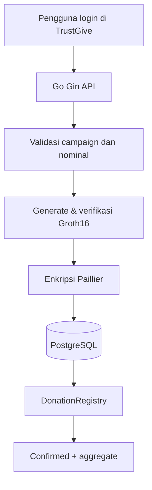

# zk-paillier-donation-system (TrustGive)

**Prototipe sistem donasi transparan berbasis blockchain, Paillier Homomorphic Encryption, dan zk-SNARK.**

> **Status:** MVP demo sidang (backend + frontend TrustGive, reliability Phase 2). **Bukan layanan keuangan produksi.** Backend masih melihat nominal donasi dalam plaintext; proof zk **belum** mengikat ciphertext Paillier (Phase 4).

**Repository:** https://github.com/izagoto/zk-paillier-donation-system

## Gambaran singkat

Pencatatan donasi yang dapat diverifikasi on-chain, enkripsi nominal dengan Paillier, agregasi homomorfik, dan validasi batas donasi dengan Groth16. Antarmuka web **TrustGive** (`frontend/`, React + Vite) mendukung alur demo lengkap tanpa API client manual: beranda, campaign, login (tanpa halaman daftar), RBAC di menu, dan form donasi.

## Akses dan role

| Role | Login | Kemampuan utama |
|---|---|---|
| Pengunjung | Tidak | Lihat campaign & agregat |
| **donor** | Ya | Donasi (ZK + blockchain) |
| **organizer** | Ya | Buat campaign |
| **auditor** | Ya | Baca data (profil + endpoint publik) |
| **admin** | Ya | Donasi + campaign + buat user |

Tidak ada **Daftar** di website. Akun dibuat via `POST /api/auth/register` (bootstrap token atau admin).  
Flow lengkap: **[docs/10-AKSES-LOGIN.md](docs/10-AKSES-LOGIN.md)**.

## Menjalankan demo (singkat)

1. PostgreSQL — set `DATABASE_URL` di `backend/.env`, lalu migrasi (`source .env` → `migrate ... up`)
2. `npx hardhat node` + deploy kontrak → `BLOCKCHAIN_CONTRACT_ADDRESS` di `.env`
3. `cd backend && go run ./cmd/server`
4. Buat akun `organizer` + `donor` via `POST /api/auth/register` + `X-Bootstrap-Token` (lihat docs)
5. `cd frontend && npm run dev` → http://localhost:5173

**Checklist sidang:** **[docs/14-SIDANG-DEMO.md](docs/14-SIDANG-DEMO.md)** · smoke API: `./backend/scripts/smoke_api.sh`  
**Troubleshooting** (`email already exists`, role pengelola, `psql`, npm audit): **[docs/11-LOCAL-SETUP.md](docs/11-LOCAL-SETUP.md)**.

## Fitur yang sudah diuji

- Login JWT (tanpa UI registrasi), RBAC donor / organizer / auditor / admin.
- Frontend TrustGive: campaign, donasi full-page, proof, status & retry, verifikasi publik, dashboard per peran, admin rekonsiliasi.
- Campaign on-chain (`max_donation`), Paillier, Groth16, `DonationRegistry` (Hardhat).
- Idempotency key (migration **000006**), replay HTTP 200, race unique constraint.
- Arsip duplikasi historis (migration **000005**) + kebijakan canonical record.
- Retry donasi `failed`, rekonsiliasi pending (admin UI + worker `DONATION_PENDING_RECONCILE_SEC`), hitung ulang agregat.

**Belum / penelitian lanjutan:** proof-to-ciphertext binding, E2E CI, observability & staging produksi — lihat [docs/09-ROADMAP.md](docs/09-ROADMAP.md) Phase 4–5.

## Teknologi

| Lapisan | Teknologi |
|---|---|
| Frontend | React, Vite, React Router (`frontend/`) |
| Backend | Go, Gin |
| Database | PostgreSQL, golang-migrate |
| Enkripsi | Paillier Homomorphic Encryption |
| Zero-knowledge | Circom, snarkjs, Groth16, Poseidon |
| Blockchain | Solidity, Hardhat, EVM JSON-RPC |
| Autentikasi | JWT |

## Alur donasi (happy path)

## Dokumentasi

| Dokumen | Isi |
|---|---|
| [PRD](docs/01-PRD.md) | Kebutuhan produk dan fitur |
| [Penelitian](docs/02-PENELITIAN.md) | Latar belakang, tujuan, batasan |
| [Goals](docs/03-GOALS.md) | Indikator keberhasilan |
| [Arsitektur](docs/04-ARSITEKTUR.md) | Komponen dan trust boundary |
| [Perancangan Sistem](docs/05-PERANCANGAN-SISTEM.md) | Modul, data, API |
| [Workflow](docs/05-WORKFLOW.md) | Alur proses |
| [Struktur Proyek](docs/06-STRUKTUR-PROYEK.md) | Direktori |
| [Teknologi](docs/07-TEKNOLOGI.md) | Stack |
| [Keamanan](docs/08-KEAMANAN.md) | Threat model |
| [Roadmap](docs/09-ROADMAP.md) | Tahapan pengembangan |
| [**Akses & login**](docs/10-AKSES-LOGIN.md) | Siapa login, bootstrap akun |
| [Setup lokal](docs/11-LOCAL-SETUP.md) | Menjalankan semua komponen |
| [Alur frontend](docs/12-FRONTEND-FLOW.md) | Halaman dan navigasi TrustGive |
| [Reliability](docs/13-RELIABILITY.md) | Idempotency, retry, rekonsiliasi |
| [Demo sidang](docs/14-SIDANG-DEMO.md) | Checklist presentasi |
| [E2E Playwright](docs/15-E2E.md) | Tes UI otomatis |
| [Keterbatasan demo](docs/16-KETERBATASAN-DEMO.md) | Scope sidang & penelitian |
| [Binding zk–Paillier (desain)](docs/17-PROOF-CIPHERTEXT-BINDING.md) | Phase 4 |
| [Backup demo](docs/18-BACKUP-RECOVERY-DEMO.md) | pg_dump & reset Hardhat |
| [Security checklist](docs/19-SECURITY-TEST-CHECKLIST.md) | Uji otomatis vs manual |
| [Template evaluasi](docs/20-TEMPLATE-EVALUASI.md) | Laporan / sidang |
| [**Manual book**](docs/21-MANUAL-BOOK.md) | Panduan penggunaan UI TrustGive (per role & halaman) |

## Keamanan

Jangan commit `.env`, private key blockchain, `JWT_SECRET`, atau kunci Paillier. Proof saat ini memverifikasi rentang nominal dan commitment Poseidon, **bukan** kesesuaian ciphertext Paillier — lihat [docs/08-KEAMANAN.md](docs/08-KEAMANAN.md).
