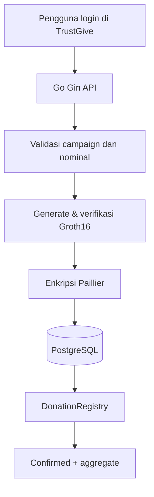

# zk-paillier-donation-system (TrustGive)

**Prototipe sistem donasi transparan berbasis blockchain, Paillier Homomorphic Encryption, dan zk-SNARK.**

> **Status:** penelitian / demo lokal (backend + frontend MVP). **Bukan layanan keuangan produksi.** Backend masih melihat nominal donasi dalam plaintext; proof zk **belum** mengikat ciphertext Paillier.

**Repository:** https://github.com/izagoto/zk-paillier-donation-system

## Gambaran singkat

Pencatatan donasi yang dapat diverifikasi on-chain, enkripsi nominal dengan Paillier, agregasi homomorfik, dan validasi batas donasi dengan Groth16. Antarmuka web **TrustGive** (`frontend/`, React + Vite) mendukung alur demo lengkap tanpa API client manual: beranda, campaign, login (tanpa halaman daftar), RBAC di menu, dan form donasi.

## Akses dan role

| Role | Login | Kemampuan utama |
|---|---|---|
| Pengunjung | Tidak | Lihat campaign & agregat |
| **donor** | Ya | Donasi (ZK + blockchain) |
| **organizer** | Ya | Buat campaign |
| **auditor** | Ya | Baca data (profil + endpoint publik) |
| **admin** | Ya | Donasi + campaign + buat user |

Tidak ada **Daftar** di website. Akun dibuat via `POST /api/auth/register` (bootstrap token atau admin).  
Flow lengkap: **[docs/10-AKSES-LOGIN.md](docs/10-AKSES-LOGIN.md)**.

## Menjalankan demo (singkat)

1. PostgreSQL — set `DATABASE_URL` di `backend/.env`, lalu migrasi (`source .env` → `migrate ... up`)
2. `npx hardhat node` + deploy kontrak → `BLOCKCHAIN_CONTRACT_ADDRESS` di `.env`
3. `cd backend && go run ./cmd/server`
4. Buat akun `organizer` + `donor` via `POST /api/auth/register` + `X-Bootstrap-Token` (lihat docs)
5. `cd frontend && npm run dev` → http://localhost:5173

**Troubleshooting** (`email already exists`, role pengelola, `psql`, npm audit): **[docs/11-LOCAL-SETUP.md](docs/11-LOCAL-SETUP.md)**.

## Fitur yang sudah diuji

- Login JWT (tanpa UI registrasi).
- Frontend TrustGive: campaign, donasi, proof, status transaksi, ringkasan agregat.
- Campaign on-chain (`max_donation`), Paillier, Groth16, `DonationRegistry` (Hardhat).
- Idempotency key pada donasi (migration **000006**).
- Arsip duplikasi historis (migration **000005**).

**Penelitian lanjutan:** rekonsiliasi DB↔chain penuh, proof-to-ciphertext binding, deployment produksi.

## Teknologi

| Lapisan | Teknologi |
|---|---|
| Frontend | React, Vite, React Router (`frontend/`) |
| Backend | Go, Gin |
| Database | PostgreSQL, golang-migrate |
| Enkripsi | Paillier Homomorphic Encryption |
| Zero-knowledge | Circom, snarkjs, Groth16, Poseidon |
| Blockchain | Solidity, Hardhat, EVM JSON-RPC |
| Autentikasi | JWT |

## Alur donasi (happy path)

## Dokumentasi

| Dokumen | Isi |
|---|---|
| [PRD](docs/01-PRD.md) | Kebutuhan produk dan fitur |
| [Penelitian](docs/02-PENELITIAN.md) | Latar belakang, tujuan, batasan |
| [Goals](docs/03-GOALS.md) | Indikator keberhasilan |
| [Arsitektur](docs/04-ARSITEKTUR.md) | Komponen dan trust boundary |
| [Perancangan Sistem](docs/05-PERANCANGAN-SISTEM.md) | Modul, data, API |
| [Workflow](docs/05-WORKFLOW.md) | Alur proses |
| [Struktur Proyek](docs/06-STRUKTUR-PROYEK.md) | Direktori |
| [Teknologi](docs/07-TEKNOLOGI.md) | Stack |
| [Keamanan](docs/08-KEAMANAN.md) | Threat model |
| [Roadmap](docs/09-ROADMAP.md) | Tahapan pengembangan |
| [Setup lokal](docs/11-LOCAL-SETUP.md) | Menjalankan semua komponen |
| [**Akses & login**](docs/10-AKSES-LOGIN.md) | Siapa login, bootstrap akun |

## Keamanan

Jangan commit `.env`, private key blockchain, `JWT_SECRET`, atau kunci Paillier. Proof saat ini memverifikasi rentang nominal dan commitment Poseidon, **bukan** kesesuaian ciphertext Paillier — lihat [docs/08-KEAMANAN.md](docs/08-KEAMANAN.md).
