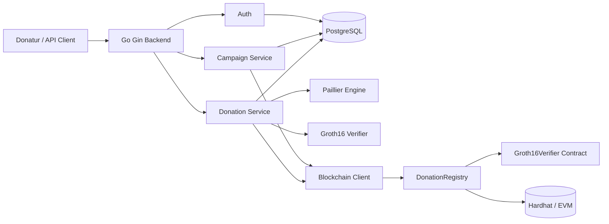

# Arsitektur Sistem

## 1. Arsitektur logis

Frontend web masih dalam rencana; pengujian sekarang menggunakan API client dan tooling.

## 2. Tanggung jawab komponen

- **Go/Gin:** validasi request, autentikasi, orkestrasi proses donasi.
- **PostgreSQL:** campaign, donation, encrypted aggregate, dan audit data.
- **Paillier:** enkripsi nominal serta operasi penjumlahan homomorfik.
- **Circom/snarkjs:** pembuatan circuit dan proof untuk pengujian.
- **Verifier backend:** validasi Groth16 proof terhadap public inputs.
- **DonationRegistry:** penyimpanan record donasi on-chain dan pemanggilan verifier.
- **Hardhat:** blockchain lokal untuk pengembangan.

## 3. Trust boundaries

1. **Client → Backend:** request tidak tepercaya; perlu validasi, otorisasi, rate limiting, dan idempotency.
2. **Backend → Database:** operasi state harus konsisten dan memiliki audit trail.
3. **Backend → Blockchain:** RPC dapat gagal, timeout, atau mengembalikan status tidak pasti; transaksi blockchain dan DB tidak atomik.
4. **Backend → Key material:** private key Paillier dan signer blockchain merupakan rahasia sensitif.
5. **Publik → Blockchain:** data on-chain dapat dibaca pihak lain; jangan menganggap ciphertext/proof menjamin anonimitas metadata.

## 4. Catatan desain kriptografi

ZK circuit saat ini memverifikasi rentang amount dan `Poseidon(amount, secret) == commitment`. Tidak ada constraint yang mengikat ciphertext Paillier. Backend juga mengetahui amount plaintext. Dengan demikian sifat privasi yang telah dicapai lebih terbatas dibandingkan tujuan akhir penelitian.

## 5. Risiko distribusi state

Kegagalan setelah transaksi blockchain berhasil tetapi sebelum DB diperbarui dapat menghasilkan status yang tidak sinkron. Solusi target meliputi idempotency, pencatatan intent/tx hash, polling receipt, state machine, dan reconciliation. Detail alur pada [WORKFLOW.md](WORKFLOW.md).
