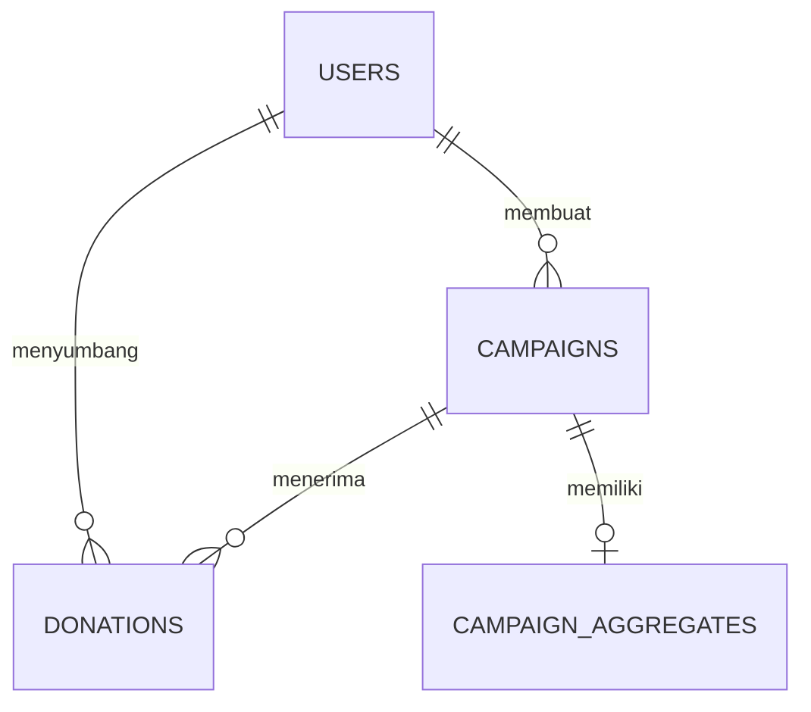

# Perancangan Sistem

## 1. Modul utama

- **Auth:** login JWT, bootstrap akun via API (tanpa registrasi di UI), validasi token.
- **Campaign:** validasi data, generate UUID, registrasi batas maksimal ke blockchain, simpan ke DB.
- **Donation:** validasi, verifikasi proof, enkripsi, persistensi, transaksi blockchain, update aggregate.
- **Cryptography:** Paillier dan ZK verifier.
- **Blockchain:** koneksi RPC, signer, interaksi smart contract.
- **Persistence:** PostgreSQL repository dan migration.

## 2. Entitas database

| Tabel | Data penting | Keterangan |
|---|---|---|
| `users` | id, email, password_hash, role | Identitas dan autentikasi |
| `campaigns` | id, title, target_amount, max_donation, status, created_by | Konfigurasi campaign |
| `donations` | id, campaign_id, donor_id, commitment, encrypted_amount, zk_proof, tx_hash, status | Record donasi |
| `campaign_aggregates` | campaign_id, encrypted_total | Akumulasi Paillier |
| `donations_duplicate_archive` | salinan record dan metadata archive | Arsip audit; dibuat di migration 000005 |

## 3. Relasi data



Tabel archive tidak diberi foreign key untuk mempertahankan bukti ketika data referensi berubah. Kebijakan retensi dan pengendalian akses tetap perlu dirancang.

## 4. API yang diketahui

| Metode | Endpoint | Tujuan |
|---|---|---|
| POST | `/api/auth/register` | Bootstrap akun (pengelola; bukan UI publik) |
| POST | `/api/auth/login` | Login → JWT |
| GET | `/api/auth/me` | Profil terautentikasi |
| POST | `/api/campaigns` | Membuat campaign (JWT) |
| GET | `/api/campaigns` | Daftar campaign (publik) |
| GET | `/api/campaigns/:id` | Detail campaign (publik) |
| GET | `/api/campaigns/:id/donations` | Riwayat donasi (publik) |
| GET | `/api/campaigns/:id/aggregate` | Agregat terenkripsi (publik) |
| POST | `/api/donations/generate-proof` | Generate proof (JWT) |
| POST | `/api/donations` | Buat donasi (JWT; header `Idempotency-Key`) |
| GET | `/api/donations/:id` | Detail donasi |

Kebijakan akses login: [10-AKSES-LOGIN.md](10-AKSES-LOGIN.md).

## 5. Input donasi yang diimplementasikan

```json
{
  "campaign_id": "<uuid>",
  "amount": "100000",
  "commitment": "<poseidon-commitment>",
  "proof": {
    "pi_a": ["..."],
    "pi_b": [["..."], ["..."], ["..."]],
    "pi_c": ["..."],
    "protocol": "groth16",
    "curve": "bn128"
  }
}
```

Nilai di atas merupakan ilustrasi struktur request, bukan proof valid yang dapat langsung dikirim.

## 6. Status transaksi

**Saat ini:** `pending` dan `confirmed`; update status masih terlalu bebas.  
**Target:** transisi status tervalidasi, idempotency, status untuk kegagalan/ketidakpastian yang didefinisikan secara eksplisit, dan reconciliation. Arsip duplikasi historis tidak boleh digunakan untuk menyamarkan transaksi confirmed yang belum bisa diverifikasi.

## 7. Aturan konsistensi

- Donasi confirmed harus memiliki bukti blockchain yang dapat dilacak sesuai lingkungan chain.
- Aggregate harus sesuai dengan himpunan donasi sah yang didefinisikan.
- Idempotency harus ditegakkan oleh database untuk mengatasi concurrent requests.
- Pemindahan data historis harus mempertahankan bukti dan tidak mengubah aggregate tanpa reconciliation.
- Perubahan skema menggunakan migration baru; jangan mengedit migration yang telah diterapkan.
