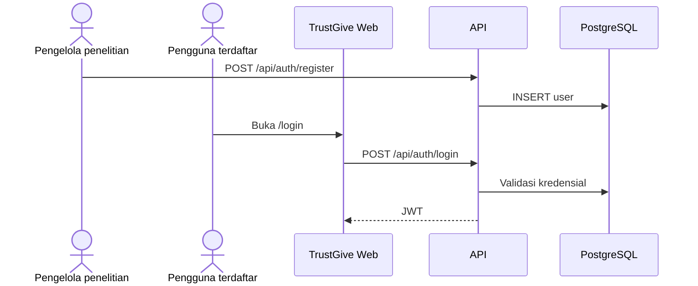
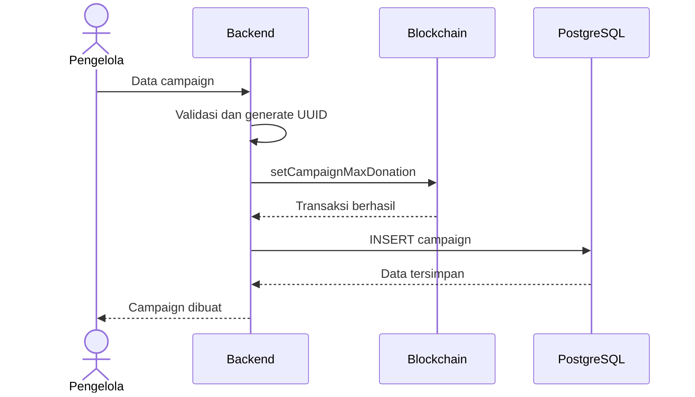
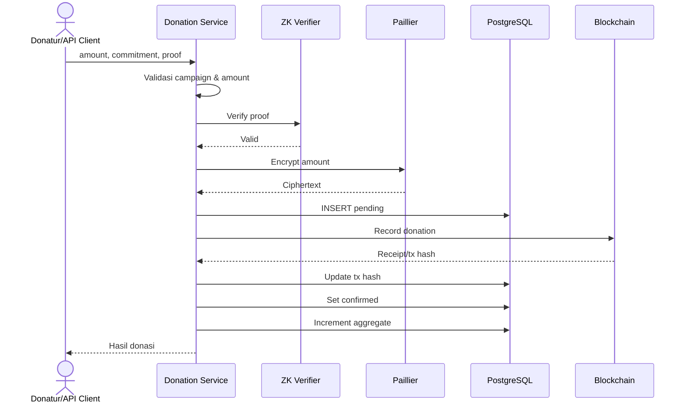
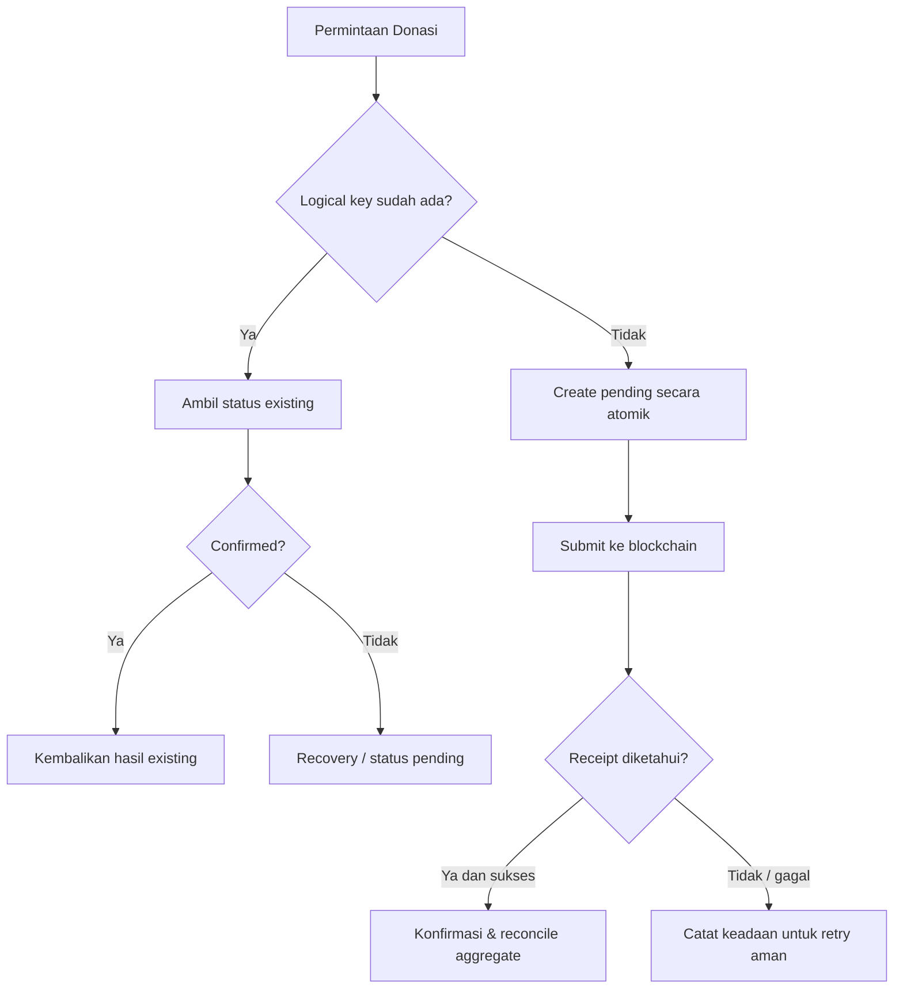

# Workflow dan Alur Proses

## 1. Bootstrap akun dan login

Registrasi **tidak** tersedia di UI TrustGive. Pengelola penelitian membuat user lewat `POST /api/auth/register` (curl/Postman). Pengguna akhir hanya **login** di web.

Detail akses: [10-AKSES-LOGIN.md](10-AKSES-LOGIN.md).

## 2. Membuat campaign (saat ini)

**Keterbatasan:** blockchain berhasil tetapi INSERT gagal belum memiliki kompensasi otomatis.

## 3. Membuat donasi (saat ini)

Alur ini hanya menggambarkan jalur berhasil. Bila langkah akhir gagal, database dan chain dapat tidak konsisten.

## 4. Target idempotency dan recovery

Candidate logical key: `(campaign_id, commitment)`; perlu validasi terhadap model ancaman dan kebijakan penggunaan ulang commitment. Constraint database harus menangani race condition.

## 5. Agregasi

Donasi confirmed yang sah → kumpulkan ciphertext → operasi Paillier Add → simpan encrypted total → dekripsi terotorisasi untuk pemeriksaan. Rebuild harus dapat dibandingkan dengan aggregate incremental.

## 6. Audit historis

- Identifikasi kelompok duplikasi tanpa mengubah record.
- Simpan backup dan bukti yang tersedia.
- Tentukan aturan canonical record yang dapat dipertanggungjawabkan.
- Jangan menyimpulkan transaksi on-chain dari hash lama bila chain Hardhat sudah di-reset.
- Lakukan rekonsiliasi aggregate sebelum/sesudah perubahan bila dibutuhkan.
- Terapkan uniqueness setelah konflik historis diselesaikan.

## 7. Kondisi akhir yang diinginkan

Setiap permintaan menghasilkan status yang dapat dijelaskan; retry tidak menggandakan donasi; transaksi on-chain dan database dapat direkonsiliasi; aggregate sesuai donasi sah; semua perubahan historis memiliki jejak audit.
