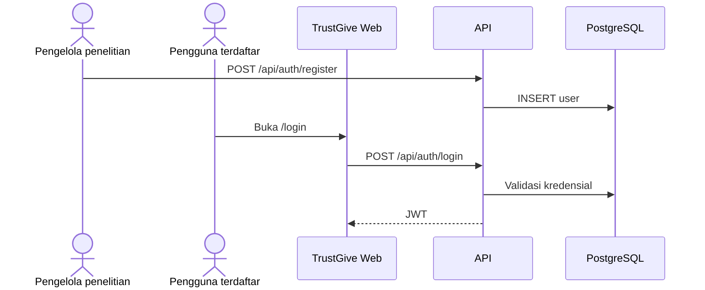
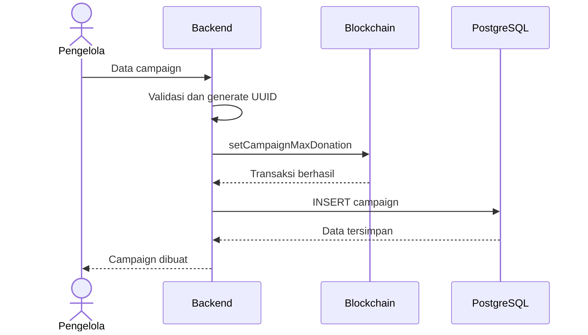
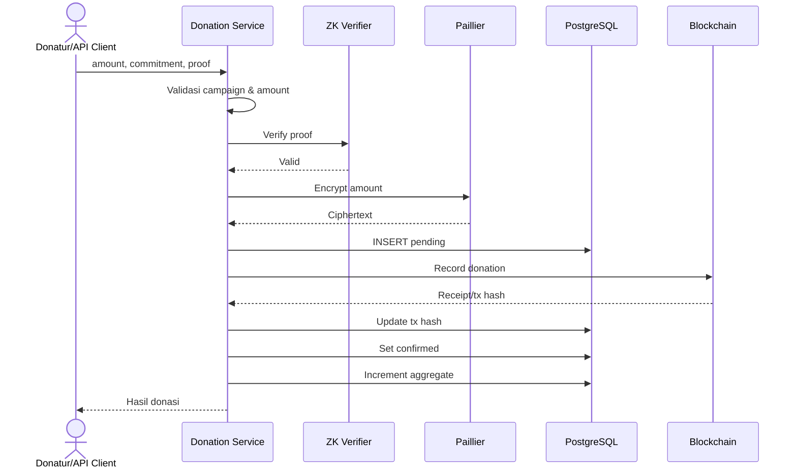
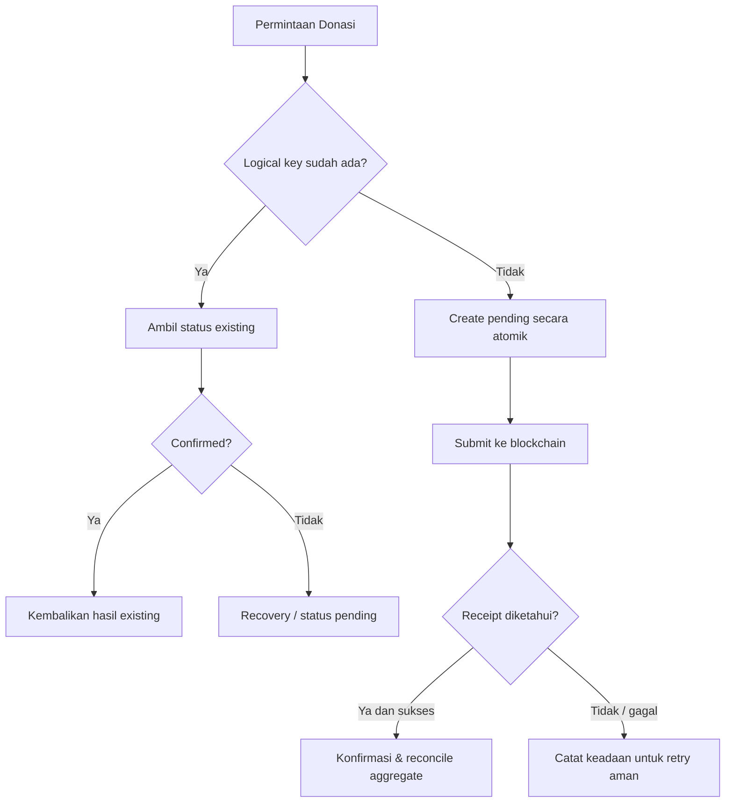
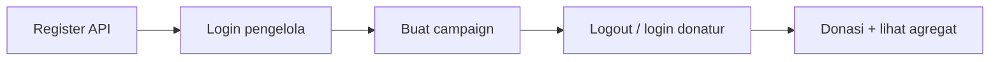

# Workflow dan Alur Proses

## 1. Bootstrap akun dan login

Registrasi **tidak** tersedia di UI TrustGive. Pengelola penelitian membuat user lewat `POST /api/auth/register` (curl/Postman). Pengguna akhir hanya **login** di web.

Detail akses: [10-AKSES-LOGIN.md](10-AKSES-LOGIN.md).

**Praktis (demo TrustGive):**

1. `source backend/.env` → register `pengelola@demo.local` (`organizer`) dan `donatur@demo.local` (`donor`) lewat curl — lihat [11-LOCAL-SETUP.md](11-LOCAL-SETUP.md).
2. Login web → redirect ke `/organizer` (pengelola) atau `/donor` (donatur/admin donasi); lihat [12-FRONTEND-FLOW.md](12-FRONTEND-FLOW.md).
3. Setelah `UPDATE users SET role = ...` di DB, **logout lalu login lagi** (role ada di JWT).

## 2. Membuat campaign (saat ini)

**Izin MVP:** `POST /api/campaigns` membutuhkan JWT role **`organizer`** atau **`admin`**.

**Keterbatasan:** blockchain berhasil tetapi INSERT gagal belum memiliki kompensasi otomatis.

## 3. Membuat donasi (saat ini)

Alur ini hanya menggambarkan jalur berhasil. Bila langkah akhir gagal, database dan chain dapat tidak konsisten.

**Izin MVP:** `generate-proof` dan `POST /api/donations` membutuhkan JWT role **`donor`** atau **`admin`**. UI memanggil backend untuk proof (demo penelitian, bukan prover di browser).

**Idempotency (implementasi saat ini):** header `Idempotency-Key` pada create donasi; lihat bagian 4 untuk target recovery penuh.

## 4. Target idempotency dan recovery

Candidate logical key: `(campaign_id, commitment)`; perlu validasi terhadap model ancaman dan kebijakan penggunaan ulang commitment. Constraint database harus menangani race condition.

## 5. Agregasi

Donasi confirmed yang sah → kumpulkan ciphertext → operasi Paillier Add → simpan encrypted total → dekripsi terotorisasi untuk pemeriksaan. Rebuild harus dapat dibandingkan dengan aggregate incremental.

## 6. Audit historis

- Identifikasi kelompok duplikasi tanpa mengubah record.
- Simpan backup dan bukti yang tersedia.
- Tentukan aturan canonical record yang dapat dipertanggungjawabkan.
- Jangan menyimpulkan transaksi on-chain dari hash lama bila chain Hardhat sudah di-reset.
- Lakukan rekonsiliasi aggregate sebelum/sesudah perubahan bila dibutuhkan.
- Terapkan uniqueness setelah konflik historis diselesaikan.

## 7. Kondisi akhir yang diinginkan

Setiap permintaan menghasilkan status yang dapat dijelaskan; retry tidak menggandakan donasi; transaksi on-chain dan database dapat direkonsiliasi; aggregate sesuai donasi sah; semua perubahan historis memiliki jejak audit.

## 8. Urutan demo sidang (mengikat §1–§3)

Prasyarat layanan: [11-LOCAL-SETUP.md](11-LOCAL-SETUP.md) (Postgres + migrate, Hardhat + deploy, backend `:8080`, frontend `:5173`).

| Langkah | Actor | Hasil yang diharapkan |
|---|---|---|
| 1 | Pengelola penelitian | Dua user di DB dengan role benar |
| 2 | `organizer` | Campaign di DB + `setCampaignMaxDonation` on-chain |
| 3 | `donor` | Donasi `confirmed`, tx hash, ciphertext, agregat ter-update |

Pengunjung tanpa login tetap bisa **membaca** campaign/donasi/agregat (transparansi demo).

## 9. Masalah umum yang memutus alur

Gejala ini sering muncul saat mengikuti diagram di atas; penjelasan lengkap ada di dokumen setup/login.

| Gejala | Dampak pada workflow | Solusi singkat |
|---|---|---|
| `email already exists` | §1 terhenti | Login akun itu atau email lain; cek `SELECT email, role FROM users` |
| Menu buat campaign hilang | §2 tidak bisa dari UI | Role harus `organizer`; `UPDATE` DB lalu **logout/login** |
| `forbidden` pada donasi | §3 gagal | Login sebagai `donor`; bukan pengelola |
| `psql` / DB salah | §1–§3 tidak konsisten dengan backend | `cd backend && source .env`; pakai `DATABASE_URL` yang sama dengan server |
| Proof / tx gagal | §3 gagal di ZK atau chain | Hardhat jalan; alamat kontrak di `.env`; jangan `npm audit fix --force` di root |
| Hardhat di-reset | §2–§3 tx lama tidak valid | Deploy ulang kontrak, update `BLOCKCHAIN_CONTRACT_ADDRESS`, campaign/donasi baru |

- Setup & troubleshooting teknis: [11-LOCAL-SETUP.md](11-LOCAL-SETUP.md)  
- Role, curl register, matriks endpoint: [10-AKSES-LOGIN.md](10-AKSES-LOGIN.md)
