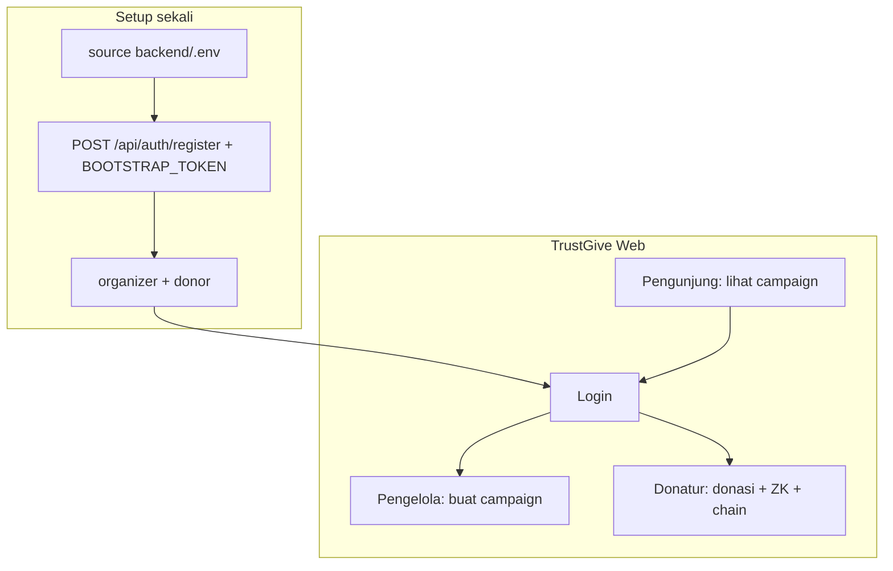

# Akses, Role, dan Login

## Role yang diimplementasikan

| Role (`users.role`) | Label | Izin API / aplikasi |
|---|---|---|
| **`donor`** | Donatur | Login; **donasi** (`generate-proof`, `POST /donations`). Tidak bisa buat campaign. |
| **`organizer`** | Pengelola campaign | Login; **buat campaign** (`POST /campaigns`). Tidak bisa donasi. |
| **`auditor`** | Auditor | Login; **hanya baca** (sama seperti pengunjung + profil). Tidak donasi / tidak buat campaign. |
| **`admin`** | Administrator | Semua izin donatur dan pengelola; **membuat user** via `POST /api/auth/register`. |

Pengunjung **tanpa login** dapat `GET` campaign, donasi, dan agregat (transparansi demo).

Enforcement: middleware `RequireRole` di backend + penyesuaian menu di frontend TrustGive.

## Flow penggunaan (demo sidang)



### Skenario dua akun (disarankan)

1. **`pengelola@demo.local`** — role `organizer` → buat campaign.
2. **`donatur@demo.local`** — role `donor` → donasi.
3. Logout antara kedua peran agar JWT dan menu UI sesuai role.

## Membuat akun

Registrasi **tidak ada di UI**. Gunakan API.

### Persiapan shell

```bash
cd backend
set -a && source .env && set +a
export BOOTSTRAP_TOKEN="$BOOTSTRAP_TOKEN"
```

Nilai `BOOTSTRAP_TOKEN` harus **sama** dengan di `backend/.env`. Jangan menulis literal `<token Anda>` di header.

### A. Database masih kosong (user pertama)

User pertama menjadi **`admin`** jika `role` tidak diisi:

```bash
curl -s -X POST http://127.0.0.1:8080/api/auth/register \
  -H "Content-Type: application/json" \
  -d '{"email":"admin@demo.local","password":"demo12345"}'
```

### B. Bootstrap token (disarankan untuk demo)

Jalankan **satu per satu** (dua baris curl terpisah):

```bash
curl -s -X POST http://127.0.0.1:8080/api/auth/register \
  -H "Content-Type: application/json" \
  -H "X-Bootstrap-Token: $BOOTSTRAP_TOKEN" \
  -d '{"email":"pengelola@demo.local","password":"demo12345","role":"organizer"}'

curl -s -X POST http://127.0.0.1:8080/api/auth/register \
  -H "Content-Type: application/json" \
  -H "X-Bootstrap-Token: $BOOTSTRAP_TOKEN" \
  -d '{"email":"donatur@demo.local","password":"demo12345","role":"donor"}'
```

Opsional auditor:

```bash
curl -s -X POST http://127.0.0.1:8080/api/auth/register \
  -H "Content-Type: application/json" \
  -H "X-Bootstrap-Token: $BOOTSTRAP_TOKEN" \
  -d '{"email":"auditor@demo.local","password":"demo12345","role":"auditor"}'
```

Respons sukses contoh: `{"id":"...","email":"...","role":"donor"}`.

### C. Admin yang sudah login

```bash
TOKEN="<access_token dari POST /api/auth/login admin>"

curl -s -X POST http://127.0.0.1:8080/api/auth/register \
  -H "Content-Type: application/json" \
  -H "Authorization: Bearer $TOKEN" \
  -d '{"email":"donatur2@demo.local","password":"demo12345","role":"donor"}'
```

## Login

### Antarmuka web (TrustGive)

- URL: http://localhost:5173/login  
- Judul form: **Masuk ke TrustGive**; tidak ada subjudul marketing di kolom kanan (value prop ada di panel biru kiri).
- **Tidak ada** tautan atau halaman registrasi; kredensial hanya dari bootstrap API (lihat atas).
- Password register minimal **8** karakter (API); login gagal selalu pesan generik di UI/API.
- Rate limit login gagal: default **10** percobaan per IP per **15** menit (`AUTH_LOGIN_MAX_ATTEMPTS`, `AUTH_LOGIN_WINDOW_MIN` di `backend/.env`). Detail: [08-KEAMANAN.md](08-KEAMANAN.md).
- Setelah login, menu menyesuaikan role: **Buat Campaign** hanya untuk `organizer` / `admin`; donasi hanya untuk `donor` / `admin`.
- Pengunjung tanpa login tetap dapat membuka beranda dan daftar campaign.

### API

- API:

```bash
curl -s -X POST http://127.0.0.1:8080/api/auth/login \
  -H "Content-Type: application/json" \
  -d '{"email":"donatur@demo.local","password":"demo12345"}'
```

- Profil: `GET /api/auth/me` dengan header `Authorization: Bearer <token>`

**Penting:** Role ada di JWT saat login. Jika role diubah di database, **logout dan login lagi**.

## Cek dan perbaiki role di database

Selalu pakai `DATABASE_URL` dari `backend/.env`:

```bash
cd backend && set -a && source .env && set +a

psql "$DATABASE_URL" -c "SELECT email, role FROM users ORDER BY email;"
```

Jika `pengelola@demo.local` masih `donor` (akun dibuat sebelum RBAC):

```bash
psql "$DATABASE_URL" -c \
  "UPDATE users SET role = 'organizer' WHERE email = 'pengelola@demo.local';"
```

## Matriks endpoint (ringkas)

| Endpoint | Publik | donor | organizer | auditor | admin |
|---|---|---|---|---|---|
| GET campaigns / aggregate / donations | ✅ | ✅ | ✅ | ✅ | ✅ |
| POST /campaigns | ❌ | ❌ | ✅ | ❌ | ✅ |
| POST /donations, generate-proof | ❌ | ✅ | ❌ | ❌ | ✅ |
| POST /auth/register | bootstrap / user pertama / admin | ❌ | ❌ | ❌ | ✅ |

## Troubleshooting singkat

| Gejala | Penyebab umum | Solusi |
|---|---|---|
| `email already exists` | Email sudah di DB | Login atau email lain |
| `forbidden` pada register | Token bootstrap salah / DB sudah terisi | Perbaiki `BOOTSTRAP_TOKEN` atau login sebagai admin |
| Menu Buat Campaign tidak muncul | JWT role masih `donor` | `UPDATE role` + logout/login |
| *Email atau kata sandi salah* padahal yakin benar | Typo password / akun belum register / role salah | Ulangi curl register; cek `users` di DB |
| *Terlalu banyak percobaan masuk* | Rate limit IP setelah banyak gagal | Tunggu ~15 menit atau restart backend (demo) |
| `psql` database "zagoto" | `DATABASE_URL` tidak di-export | `source backend/.env` |
| `role zkdonation does not exist` | URL Docker dipakai di Postgres lokal | Sesuaikan `DATABASE_URL` di `.env` |

Detail: [11-LOCAL-SETUP.md](11-LOCAL-SETUP.md).

## Catatan keamanan demo

- Set `BOOTSTRAP_TOKEN` kuat jika API bisa diakses dari luar localhost.
- Role **`auditor`**: dashboard `/auditor` (campaign aktif + panduan verifikasi); hak baca mengikuti endpoint publik.

Lihat [08-KEAMANAN.md](08-KEAMANAN.md).
