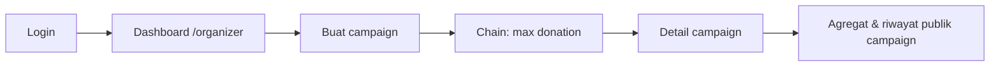

# Alur Frontend (scope penelitian)

Dokumen ini melengkapi [05-WORKFLOW.md](05-WORKFLOW.md) dengan rute UI dan peran pengguna.

## Peran dan rute utama

| Peran | Setelah login | Navigasi khas |
|-------|----------------|---------------|
| `donor` | `/donor` | Campaign, Dashboard Donatur, Donasi Saya |
| `organizer` | `/organizer` | Dashboard Pengelola, Buat Campaign, Campaign Saya (`/campaigns?mine=1`) |
| `admin` | `/donor` (donasi) + bisa buat campaign | Gabungan izin donor dan pengelola |

Registrasi hanya lewat API; UI hanya **login** ([10-AKSES-LOGIN.md](10-AKSES-LOGIN.md)).

## Alur donatur

```mermaid
flowchart LR
  A[Login] --> B[Dashboard /donor]
  B --> C[List campaign]
  C --> D[Detail campaign]
  D --> E[Nominal]
  E --> F[Konfirmasi]
  F --> G[Proof + chain]
  G --> H[/donor/donations]
```

1. **Nominal** — input atau chip cepat.
2. **Konfirmasi** — ringkasan nominal; tidak ada plaintext on-chain.
3. **Proses** — `POST /api/donations/generate-proof` lalu `POST /api/donations` (idempotency key).
4. **Riwayat** — `GET /api/me/donations` (JWT `user_id` sebagai `donor_id`).

## Alur pengelola



Filter **Campaign saya**: `created_by === user.id` di klien (`?mine=1`).

## Layout UI

- **Tamu (belum login):** topbar publik (`PublicLayout`) — Beranda, Campaign, Masuk.
- **Sudah login:** **sidebar workspace** 248px + header 64px (`WorkspaceLayout`), nav per role.
- Styling workspace: **Tailwind CSS v4** + token TrustGive; login/beranda tamu masih memakai `index.css` legacy.

## Beranda (`/`)

- Tamu: penjelasan penelitian + **Panduan demo** (alur donatur vs pengelola) + cuplikan 3 campaign.
- Sudah login: akses `/` di-redirect ke dashboard peran (`/organizer` atau `/donor`).

## Halaman organizer (nav sidebar)

| Menu | URL |
|------|-----|
| Dashboard | `/organizer` |
| Campaign Saya | `/campaigns?mine=1` (tabel manajemen) |
| Buat Campaign | `/campaigns/new` |
| Aktivitas Donasi | `/organizer/donations` |
| Profil | `/organizer/profile` |

## Halaman donor (nav sidebar)

| Menu | URL |
|------|-----|
| Dashboard | `/donor` |
| Jelajahi Campaign | `/campaigns` |
| Donasi Saya | `/donor/donations` |
| Profil | `/donor/profile` |

## Referensi visual

Prototype 7 layar: [prototype/trustgive-ui-board.html](prototype/trustgive-ui-board.html).

## Batasan penelitian (tetap berlaku)

- Proof dihasilkan di backend (bukan browser prover).
- Nominal plaintext ada di server untuk demo agregat/dekripsi.
- Recovery DB ↔ chain penuh masih di roadmap ([09-ROADMAP.md](09-ROADMAP.md)).
